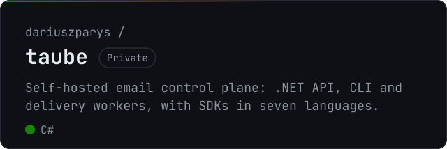
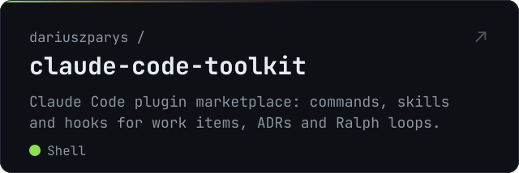
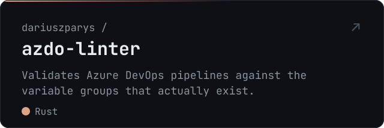
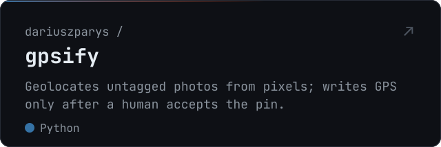

<picture>
  <source media="(prefers-color-scheme: dark)" srcset="assets/banner-dark.svg">
  <source media="(prefers-color-scheme: light)" srcset="assets/banner-light.svg">
  
</picture>

 

<picture>
  <source media="(prefers-color-scheme: dark)" srcset="assets/terminal-dark.svg">
  <source media="(prefers-color-scheme: light)" srcset="assets/terminal-light.svg">
  
</picture>

### `01` &nbsp;Currently building

<picture><source media="(prefers-color-scheme: dark)" srcset="assets/projects/taube-dark.svg"><source media="(prefers-color-scheme: light)" srcset="assets/projects/taube-light.svg"></picture> <a href="https://github.com/dariuszparys/claude-code-toolkit"><picture><source media="(prefers-color-scheme: dark)" srcset="assets/projects/claude-code-toolkit-dark.svg"><source media="(prefers-color-scheme: light)" srcset="assets/projects/claude-code-toolkit-light.svg"></picture></a>
<a href="https://github.com/dariuszparys/azdo-linter"><picture><source media="(prefers-color-scheme: dark)" srcset="assets/projects/azdo-linter-dark.svg"><source media="(prefers-color-scheme: light)" srcset="assets/projects/azdo-linter-light.svg"></picture></a> <a href="https://github.com/dariuszparys/gpsify"><picture><source media="(prefers-color-scheme: dark)" srcset="assets/projects/gpsify-dark.svg"><source media="(prefers-color-scheme: light)" srcset="assets/projects/gpsify-light.svg"></picture></a>

### `02` &nbsp;Contributor to

- [**Eclipse Chariott**](https://github.com/eclipse-chariott/chariott): a gRPC service that gives in-vehicle applications one common interface to talk to each other
- [**Rust for .NET developers**](https://microsoft.github.io/rust-for-dotnet-devs/latest/): learning Rust through the lens of C# and .NET

### `03` &nbsp;Toolbox

<picture>
  <source media="(prefers-color-scheme: dark)" srcset="https://skillicons.dev/icons?i=rust%2Ccs%2Cdotnet%2Cts%2Cpython%2Cgo%2Cazure%2Cterraform%2Cdocker%2Cgithubactions%2Clinux%2Cbash&theme=dark">
  <source media="(prefers-color-scheme: light)" srcset="https://skillicons.dev/icons?i=rust%2Ccs%2Cdotnet%2Cts%2Cpython%2Cgo%2Cazure%2Cterraform%2Cdocker%2Cgithubactions%2Clinux%2Cbash&theme=light">
  
</picture>

### `04` &nbsp;Latest writing

<!-- BLOG-POST-LIST:START -->- [Running a 2.5 hour job from a 60 minute pipeline: Azure Container Apps Jobs, kickoff and collect](https://www.dariuszparys.com/azure-container-apps-jobs-kickoff-and-collect) · Sep 1, 2026
- [Your ADRs Are Costing You Tokens](https://www.dariuszparys.com/your-adrs-are-costing-you-tokens) · Mar 2, 2026
- [Claude Code Multi-Agent tmux Setup](https://www.dariuszparys.com/claude-code-multi-agent-tmux-setup) · Feb 7, 2026
- [Building an Autonomous Coding Agent with the GitHub Copilot SDK](https://www.dariuszparys.com/building-an-autonomous-coding-agent-with-the-github-copilot-sdk) · Jan 27, 2026
- [The 3-Hour Clone](https://www.dariuszparys.com/the-3-hour-clone) · Jan 16, 2026
<!-- BLOG-POST-LIST:END -->

→ more at <a href="https://www.dariuszparys.com">dariuszparys.com</a>

 

<picture>
  <source media="(prefers-color-scheme: dark)" srcset="assets/footer-dark.svg">
  <source media="(prefers-color-scheme: light)" srcset="assets/footer-light.svg">
  
</picture>
